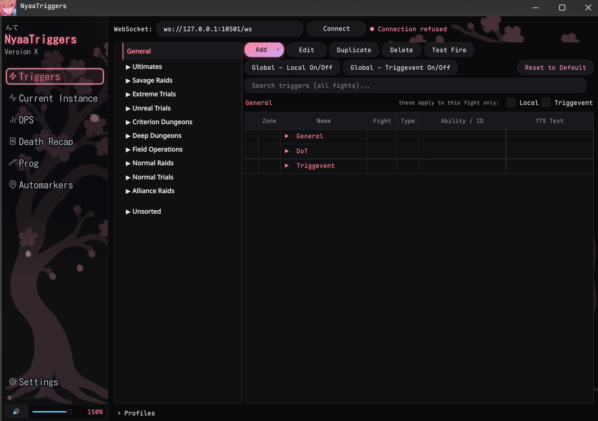

# NyaaTriggers

An FFXIV trigger manager that connects to [IINACT](https://github.com/marzent/IINACT) for spoken callouts, live DPS, death recaps, and prog sessions. Party automarkers use the Telesto plugin. English and Japanese are supported. Request other languages through an issue.

**Linux · Windows** · **[Download](https://github.com/CateDesu/NyaaTriggers/releases/latest)** · [Full guide](docs/GUIDE.md) · [Changelog](CHANGELOG.md) · [Discord](https://discord.com/invite/TQJrbZcgKF)

## Getting started

1. Download the Windows `.zip` or Linux `.tar.gz` above and extract the whole folder somewhere writable.
2. **Windows:** run `NyaaTriggers.exe`, keeping `_internal` beside it. **Linux:** install the [system dependencies](docs/GUIDE.md#linux-system-dependencies), then run `NyaaTriggers.sh`.
3. [Install and enable IINACT](docs/GUIDE.md#connecting-to-iinact), log into your character, then connect NyaaTriggers to `ws://127.0.0.1:10501/ws`.

[Detailed installation](docs/GUIDE.md#installation) · [Run from source](docs/GUIDE.md#linux-from-source)

## Documentation

| Topic | Guide |
|---|---|
| Callouts | [Triggers and editors](docs/GUIDE.md#triggers-tab) · [Triggevent](docs/GUIDE.md#triggevent-engine) · [Custom sequences](docs/GUIDE.md#custom-triggevent-callouts) · [Triggernometry packs](docs/GUIDE.md#triggernometry-engine-wip) |
| Saved setups | [Profiles](docs/GUIDE.md#profiles) |
| Combat records | [DPS](docs/GUIDE.md#dps-tab) · [Death recaps](docs/GUIDE.md#death-recap-tab) · [Prog sessions](docs/GUIDE.md#prog-tab) |
| Audio and language | [Voice](docs/GUIDE.md#voice) · [Alert sounds](docs/GUIDE.md#alert-sound) · [Language and settings](docs/GUIDE.md#settings) |
| In-game tools | [Overlay](docs/GUIDE.md#in-game-display) · [Automarkers](docs/GUIDE.md#automarkers-tab) |
| Maintenance | [Updating](docs/GUIDE.md#updating) · [Saved data and backups](docs/GUIDE.md#saved-data) · [Personal triggers](docs/GUIDE.md#personal-triggers) |
| Help | [Troubleshooting callouts](docs/GUIDE.md#troubleshooting-callouts) · [Report an issue](https://github.com/CateDesu/NyaaTriggers/issues) |

Developer references: [Triggevent engine](triggevent-core/README.md) · [Triggernometry engine](triggernometry-core/README.md) · [Tests](tests/README.md) · [Planned work](docs/TODO.md)

## License

MIT. Bundled engines and dependencies retain their own licenses.
